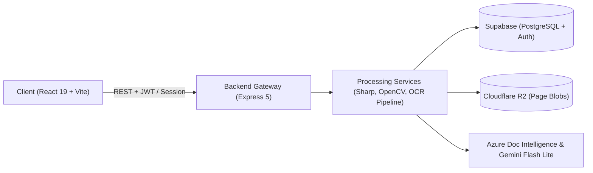

# System Architecture (Living Draft)

> [!NOTE]
> **Status: Initial Draft (Living Document) — captures baseline architecture during active development.**

---

## 1. Document Status & System Overview

**Arkhive** is an intelligent document processing web application that transforms photos and scanned documents (receipts, financial statements, tabular forms, and multi-page PDFs) into structured, editable, and exportable data. The stack consists of a **React 19 / TypeScript / Vite** single-page application and a **Node.js 22+ / Express 5 / TypeScript** backend, backed by **Supabase** (PostgreSQL with Row-Level Security and Supabase Auth), **Cloudflare R2** (S3-compatible object storage), **Azure Document Intelligence** (layout analysis), and **Google Gemini Flash Lite** (document classification, table structuring, schema mapping, and interactive verification chat).

The complete system architecture and end-to-end data pipelines are visualized in [`ARCHITECTURE_DIAGRAM.mmd`](./ARCHITECTURE_DIAGRAM.mmd). The flow starts when a user uploads document pages in the frontend (split client-side via PDF.js), which are preprocessed with Sharp/OpenCV (blur/lighting/contrast analysis) and stored in Cloudflare R2; pages are then processed through pre-OCR unsharp masking, Azure Document Intelligence, and a profile-driven OCR pipeline leveraging Gemini Flash Lite to extract bounding-box-linked tables for side-by-side interactive validation.



---

## 2. Repository Layout (Top-Level)

The repository is structured as a decoupled full-stack workspace with independent frontend and backend packages coordinated by root-level tooling and Docker configurations:

```text
2026W1-Arkhive/
├── .github/              # GitHub Actions CI workflows for test execution, docker builds, and security scans
├── .husky/               # Git pre-commit & pre-push hooks enforcing lint-staged and test suites
├── backend/              # Node.js/Express API service, modular OCR pipeline, LLM integrations, and Supabase migrations
├── docs/                 # Documentation, specifications, and User Acceptance Testing (UAT) materials
├── frontend/             # React 19 single-page application built with Vite, Tailwind CSS v4, and DaisyUI
│   ├── e2e/              # Playwright end-to-end tests and test fixtures
│   └── src/services/export/ # Modular multi-format export engines (CSV, XLSX, JSON, TXT, templates)
├── Dockerfile            # Multi-stage container definition compiling frontend assets into backend public dir
├── cloudbuild.yaml       # Google Cloud Build deployment configuration targeting Google Cloud Run
├── package.json          # Root configuration managing repository-wide dev dependencies (Husky, Prettier, ESLint)
└── ARCHITECTURE_DIAGRAM.mmd # Standalone Mermaid.js diagram illustrating component topology and request flows
```

- **`.github/`**: Houses automated CI pipelines (`ci.yml`) running frontend/backend unit tests, integration tests, container builds, and Trivy security audits.
- **`.husky/`**: Automates pre-commit and pre-push code verification to ensure formatting, linting, and tests pass before code reaches git history.
- **`backend/`**: Contains the Express REST API, database access layers, cloud storage integrations, image analysis, modular OCR pipeline, and Gemini Flash Lite services.
- **`docs/`**: Stores supplementary documentation, acceptance criteria, and operational guides.
- **`frontend/`**: Contains the client-side user interface, interactive table editors, document viewer, AI assistant panels, and Playwright E2E suites.
- **`Dockerfile`**: Defines the two-stage production container build (frontend Vite build stage + Node 22+ backend runtime).
- **`cloudbuild.yaml`**: Provides automated CI/CD deployment instructions for Google Cloud Run.
- **`package.json`**: Coordinates root developer dependencies, lint-staged commands, and workspace-wide formatting scripts.
- **`ARCHITECTURE_DIAGRAM.mmd`**: Provides the primary Mermaid-syntax architecture diagram referenced by this document.

---

## 3. Frontend Breakdown (`frontend/`)

The frontend is a single-page application built with **React 19**, **TypeScript**, and **Vite**, styled with **Tailwind CSS v4** and **DaisyUI 5**. It features client-side PDF rasterization (`pdfjs-dist`), side-by-side document/table comparison, in-cell data editing with undo/redo history, and a Gemini-powered verification assistant.

### Directory Roles

| Folder Path                                                                                                                             | What Lives Here                                                                                                                                                                                                                                                                                                                                                                                                                                                                                                                                                                                                 | Newcomer Rule of Thumb                                                                                 |
| :-------------------------------------------------------------------------------------------------------------------------------------- | :-------------------------------------------------------------------------------------------------------------------------------------------------------------------------------------------------------------------------------------------------------------------------------------------------------------------------------------------------------------------------------------------------------------------------------------------------------------------------------------------------------------------------------------------------------------------------------------------------------------- | :----------------------------------------------------------------------------------------------------- |
| [`frontend/src/pages/`](file:///Users/simon/Desktop/Uni/Engineering/2026/FIT3170/2026W1-Arkhive/frontend/src/pages)                     | Route-level views (`home`, `login`, `projects`, `upload`, `validation`) and page-specific sub-layouts.                                                                                                                                                                                                                                                                                                                                                                                                                                                                                                          | Top-level orchestrators only; manage high-level view state and compose shared components.              |
| [`frontend/src/components/`](file:///Users/simon/Desktop/Uni/Engineering/2026/FIT3170/2026W1-Arkhive/frontend/src/components)           | Shared cross-page UI components including [`AuthGuard`](file:///Users/simon/Desktop/Uni/Engineering/2026/FIT3170/2026W1-Arkhive/frontend/src/components/auth/AuthGuard.tsx), [`RequireUser`](file:///Users/simon/Desktop/Uni/Engineering/2026/FIT3170/2026W1-Arkhive/frontend/src/components/auth/RequireUser.tsx), [`Navbar`](file:///Users/simon/Desktop/Uni/Engineering/2026/FIT3170/2026W1-Arkhive/frontend/src/components/navbar/Navbar.tsx), and [`OcrProgressPopup`](file:///Users/simon/Desktop/Uni/Engineering/2026/FIT3170/2026W1-Arkhive/frontend/src/components/ocr-progress/OcrProgressPopup.tsx). | Stateless or layout-focused UI; no direct backend API fetching or route transitions.                   |
| [`frontend/src/context/`](file:///Users/simon/Desktop/Uni/Engineering/2026/FIT3170/2026W1-Arkhive/frontend/src/context)                 | Global React Context providers ([`AuthProvider`](file:///Users/simon/Desktop/Uni/Engineering/2026/FIT3170/2026W1-Arkhive/frontend/src/context/AuthProvider.tsx), [`OcrProgressProvider`](file:///Users/simon/Desktop/Uni/Engineering/2026/FIT3170/2026W1-Arkhive/frontend/src/context/OcrProgressProvider.tsx)).                                                                                                                                                                                                                                                                                                | Reserved for truly global state (active user credentials, session tokens, and async OCR job progress). |
| [`frontend/src/hooks/`](file:///Users/simon/Desktop/Uni/Engineering/2026/FIT3170/2026W1-Arkhive/frontend/src/hooks)                     | Custom React hooks managing complex local workflows (`useTableEditor`, `useUndoRedo`, `useProjects`, `useReviewQueue`, `useChat`).                                                                                                                                                                                                                                                                                                                                                                                                                                                                              | Encapsulate mutable state logic, keyboard handlers, and undo/redo stacks; avoid rendering markup.      |
| [`frontend/src/services/`](file:///Users/simon/Desktop/Uni/Engineering/2026/FIT3170/2026W1-Arkhive/frontend/src/services)               | Network API clients ([`documentService`](file:///Users/simon/Desktop/Uni/Engineering/2026/FIT3170/2026W1-Arkhive/frontend/src/services/documentService.ts), [`projectService`](file:///Users/simon/Desktop/Uni/Engineering/2026/FIT3170/2026W1-Arkhive/frontend/src/services/projectService.ts), [`uploadService`](file:///Users/simon/Desktop/Uni/Engineering/2026/FIT3170/2026W1-Arkhive/frontend/src/services/uploadService.ts), [`llmService`](file:///Users/simon/Desktop/Uni/Engineering/2026/FIT3170/2026W1-Arkhive/frontend/src/services/llmService.ts)).                                               | All HTTP requests and file blob downloads belong here; keep decoupled from React component lifecycles. |
| [`frontend/src/services/export/`](file:///Users/simon/Desktop/Uni/Engineering/2026/FIT3170/2026W1-Arkhive/frontend/src/services/export) | Modular export pipeline (`batchExportService.ts`, `csvDownloadService.ts`, `xlsxDownloadService.ts`, `jsonDownloadService.ts`, `txtDownloadService.ts`, format templates, XLSX writer, and zip packager).                                                                                                                                                                                                                                                                                                                                                                                                       | Implement file generation, column formatting rules, and template serializers here.                     |
| [`frontend/src/utils/`](file:///Users/simon/Desktop/Uni/Engineering/2026/FIT3170/2026W1-Arkhive/frontend/src/utils)                     | Pure data transformation functions (`flattener.ts`, `fieldMapping.ts`, `tableOperations.ts`, `indentEditor.ts`, format regex detectors).                                                                                                                                                                                                                                                                                                                                                                                                                                                                        | Pure, deterministic utility functions only; must be free of side effects and easy to unit test.        |
| [`frontend/src/models/`](file:///Users/simon/Desktop/Uni/Engineering/2026/FIT3170/2026W1-Arkhive/frontend/src/models)                   | Shared frontend TypeScript interfaces and domain schemas ([`Document.ts`](file:///Users/simon/Desktop/Uni/Engineering/2026/FIT3170/2026W1-Arkhive/frontend/src/models/Document.ts), `Project.ts`, `TableData.ts`, `IssueReview.ts`, `OcrTask.ts`).                                                                                                                                                                                                                                                                                                                                                              | Type definitions and data contracts only; no runtime implementation code.                              |
| [`frontend/e2e/`](file:///Users/simon/Desktop/Uni/Engineering/2026/FIT3170/2026W1-Arkhive/frontend/e2e)                                 | Playwright end-to-end integration and smoke tests (`smoke.spec.ts`, `LoginPage.ts`, fixtures).                                                                                                                                                                                                                                                                                                                                                                                                                                                                                                                  | End-to-end browser regression and user workflow tests; run via `npm run test:e2e`.                     |
| [`frontend/src/mock-data/`](file:///Users/simon/Desktop/Uni/Engineering/2026/FIT3170/2026W1-Arkhive/frontend/src/mock-data)             | Static fixtures for tests and offline development (sample bounding boxes, test PDFs).                                                                                                                                                                                                                                                                                                                                                                                                                                                                                                                           | Test fixture assets only; never bundle into production execution paths.                                |
| [`frontend/public/`](file:///Users/simon/Desktop/Uni/Engineering/2026/FIT3170/2026W1-Arkhive/frontend/public)                           | Public assets, web manifests, favicons, and export format iconography (`export_images/csv/`).                                                                                                                                                                                                                                                                                                                                                                                                                                                                                                                   | Static files served directly without bundling; referenced by root path (e.g. `/icons.svg`).            |

### State Management & API Communication Conventions

1. **Authentication & Session State:**
   - Managed globally by [`AuthProvider`](file:///Users/simon/Desktop/Uni/Engineering/2026/FIT3170/2026W1-Arkhive/frontend/src/context/AuthProvider.tsx).
   - Authenticated sessions obtain a Supabase JWT stored by the Supabase client.
   - Unauthenticated users can choose "Continue as Guest", setting `arkhive_guest_mode` in `sessionStorage` to access ephemeral upload and validation views without an account.
2. **Page & Component State:**
   - Ephemeral UI state (selected cells, hovered bounding boxes, zoom levels, review queue indexes) is handled by local React state and specialized custom hooks ([`useTableEditor`](file:///Users/simon/Desktop/Uni/Engineering/2026/FIT3170/2026W1-Arkhive/frontend/src/hooks/useTableEditor.ts), [`useUndoRedo`](file:///Users/simon/Desktop/Uni/Engineering/2026/FIT3170/2026W1-Arkhive/frontend/src/hooks/useUndoRedo.ts), [`useReviewQueue`](file:///Users/simon/Desktop/Uni/Engineering/2026/FIT3170/2026W1-Arkhive/frontend/src/hooks/review/useReviewQueue.ts)).
   - Background multi-page OCR job state is tracked globally via [`OcrProgressProvider`](file:///Users/simon/Desktop/Uni/Engineering/2026/FIT3170/2026W1-Arkhive/frontend/src/context/OcrProgressProvider.tsx), allowing users to navigate between projects while extraction runs.
3. **Backend Communication:**
   - All network calls flow through functions in [`frontend/src/services/`](file:///Users/simon/Desktop/Uni/Engineering/2026/FIT3170/2026W1-Arkhive/frontend/src/services).
   - Functions automatically attach the current Supabase JWT Bearer token to request headers via `getAuthHeaders()` when interacting with authenticated routes.
   - The base URL is configured via [`apiBase.ts`](file:///Users/simon/Desktop/Uni/Engineering/2026/FIT3170/2026W1-Arkhive/frontend/src/services/apiBase.ts), which defaults to relative `/api/*` paths during local development and production (proxied by Vite or served by Express).

---

## 4. Backend Breakdown (`backend/`)

The backend is built with **Node.js 22**, **Express 5**, and **TypeScript**, executed with `tsx`. It coordinates image preprocessing, cloud storage, optical character recognition, and generative AI queries.

### Request Progression & Architectural Layers

```text
HTTP Request
     │
     ▼
[Middleware Layer] ──> requireAuth (Supabase JWT) / express-session / multer (Memory/Disk)
     │
     ▼
[Routing Layer]    ──> /api/projects, /api/documents, /api/upload, /api/extraction, /api/llm, /api/qr
     │
     ▼
[Controller Layer] ──> Input validation, user authorization checks, response status formatting
     │
     ▼
[Service Layer]    ──> imageProcessor (Sharp/OpenCV), r2Client (S3), ocr (ocr.ts, pipeline/, analyseBuffer), aiService (Gemini Flash Lite)
     │
     ▼
[Persistence/Ext]  ──> Supabase PostgreSQL (via Service Role Client), Cloudflare R2, Azure DI, Gemini Flash Lite API
```

| Folder Path                                                                                                                                                  | What Lives Here                                                                                                                                                                                                                                                                                                                                                                                                                                                                                                                                                                                                                                                                                                                                                                                                                                                                                                                                                                                                                                                                                                                                                                                                                                                                                            | Layer / Flow Stage                      |
| :----------------------------------------------------------------------------------------------------------------------------------------------------------- | :--------------------------------------------------------------------------------------------------------------------------------------------------------------------------------------------------------------------------------------------------------------------------------------------------------------------------------------------------------------------------------------------------------------------------------------------------------------------------------------------------------------------------------------------------------------------------------------------------------------------------------------------------------------------------------------------------------------------------------------------------------------------------------------------------------------------------------------------------------------------------------------------------------------------------------------------------------------------------------------------------------------------------------------------------------------------------------------------------------------------------------------------------------------------------------------------------------------------------------------------------------------------------------------------------------- | :-------------------------------------- |
| [`backend/app.ts`](file:///Users/simon/Desktop/Uni/Engineering/2026/FIT3170/2026W1-Arkhive/backend/app.ts)                                                   | Root server process entrypoint. Binds port listener, imports Express app, and runs periodic cleanup of ephemeral upload directories.                                                                                                                                                                                                                                                                                                                                                                                                                                                                                                                                                                                                                                                                                                                                                                                                                                                                                                                                                                                                                                                                                                                                                                       | **Server Runtime Entrypoint**           |
| [`backend/src/app.ts`](file:///Users/simon/Desktop/Uni/Engineering/2026/FIT3170/2026W1-Arkhive/backend/src/app.ts)                                           | Express instance configuration. Mounts body parsers, sessions, API route groups, static frontend serving, and SPA route fallback.                                                                                                                                                                                                                                                                                                                                                                                                                                                                                                                                                                                                                                                                                                                                                                                                                                                                                                                                                                                                                                                                                                                                                                          | **Application Bootstrap**               |
| [`backend/src/middleware/`](file:///Users/simon/Desktop/Uni/Engineering/2026/FIT3170/2026W1-Arkhive/backend/src/middleware)                                  | Request interceptors, prominently [`auth.ts`](file:///Users/simon/Desktop/Uni/Engineering/2026/FIT3170/2026W1-Arkhive/backend/src/middleware/auth.ts) (`requireAuth`). Verifies Supabase Bearer JWTs and populates `req.userId`.                                                                                                                                                                                                                                                                                                                                                                                                                                                                                                                                                                                                                                                                                                                                                                                                                                                                                                                                                                                                                                                                           | **Security & Authentication**           |
| [`backend/src/routes/`](file:///Users/simon/Desktop/Uni/Engineering/2026/FIT3170/2026W1-Arkhive/backend/src/routes)                                          | Express route definitions ([`documentRoutes`](file:///Users/simon/Desktop/Uni/Engineering/2026/FIT3170/2026W1-Arkhive/backend/src/routes/documentRoutes.ts), [`projectRoutes`](file:///Users/simon/Desktop/Uni/Engineering/2026/FIT3170/2026W1-Arkhive/backend/src/routes/projectRoutes.ts), [`llmRoutes`](file:///Users/simon/Desktop/Uni/Engineering/2026/FIT3170/2026W1-Arkhive/backend/src/routes/llmRoutes.ts), [`upload`](file:///Users/simon/Desktop/Uni/Engineering/2026/FIT3170/2026W1-Arkhive/backend/src/routes/upload.ts), [`qr`](file:///Users/simon/Desktop/Uni/Engineering/2026/FIT3170/2026W1-Arkhive/backend/src/routes/qr.ts)). Multer upload policies are configured here.                                                                                                                                                                                                                                                                                                                                                                                                                                                                                                                                                                                                              | **Routing & Payload Ingestion**         |
| [`backend/src/controller/`](file:///Users/simon/Desktop/Uni/Engineering/2026/FIT3170/2026W1-Arkhive/backend/src/controller)                                  | Request controllers ([`documents.ts`](file:///Users/simon/Desktop/Uni/Engineering/2026/FIT3170/2026W1-Arkhive/backend/src/controller/documents.ts), [`projects.ts`](file:///Users/simon/Desktop/Uni/Engineering/2026/FIT3170/2026W1-Arkhive/backend/src/controller/projects.ts), [`llm.ts`](file:///Users/simon/Desktop/Uni/Engineering/2026/FIT3170/2026W1-Arkhive/backend/src/controller/llm.ts), [`upload.ts`](file:///Users/simon/Desktop/Uni/Engineering/2026/FIT3170/2026W1-Arkhive/backend/src/controller/upload.ts), [`qrController.ts`](file:///Users/simon/Desktop/Uni/Engineering/2026/FIT3170/2026W1-Arkhive/backend/src/controller/qrController.ts)). Handles parameter validation and orchestrates domain calls.                                                                                                                                                                                                                                                                                                                                                                                                                                                                                                                                                                             | **Controller & Validation Layer**       |
| [`backend/src/services/imageProcessor.ts`](file:///Users/simon/Desktop/Uni/Engineering/2026/FIT3170/2026W1-Arkhive/backend/src/services/imageProcessor.ts)   | Image analysis service. Inspects page buffers using Sharp and OpenCV for blur, glare, lighting, and contrast metrics, generating structured `QualityFlags`.                                                                                                                                                                                                                                                                                                                                                                                                                                                                                                                                                                                                                                                                                                                                                                                                                                                                                                                                                                                                                                                                                                                                                | **Image Quality Heuristics**            |
| [`backend/src/services/ocrPreprocessor.ts`](file:///Users/simon/Desktop/Uni/Engineering/2026/FIT3170/2026W1-Arkhive/backend/src/services/ocrPreprocessor.ts) | JIT pre-OCR image enhancement. Converts raw RGBA to grayscale and executes Unsharp Masking (`cv.GaussianBlur` + `cv.addWeighted`) to sharpen text strokes and boundary edges without introducing pixel distortion before cloud OCR analysis.                                                                                                                                                                                                                                                                                                                                                                                                                                                                                                                                                                                                                                                                                                                                                                                                                                                                                                                                                                                                                                                               | **Pre-OCR Image Filter**                |
| [`backend/src/services/ocr/`](file:///Users/simon/Desktop/Uni/Engineering/2026/FIT3170/2026W1-Arkhive/backend/src/services/ocr)                              | Modular OCR coordination & extraction architecture:<ul><li>[`ocr.ts`](file:///Users/simon/Desktop/Uni/Engineering/2026/FIT3170/2026W1-Arkhive/backend/src/services/ocr/ocr.ts): Master coordinator with retry backoff (`parseDocumentWithRetries`), piping buffers through `prepareForOCR`, Azure layout analysis, and document structuring.</li><li>[`pipeline/`](file:///Users/simon/Desktop/Uni/Engineering/2026/FIT3170/2026W1-Arkhive/backend/src/services/ocr/pipeline/): Profile-driven structuring pipeline (`pipeline.ts`) supporting document classification via Gemini Flash Lite (`gemini-flash-lite-latest`), sequential line-claiming extractors (`extractors.ts`: `nativeTableExtractor`, `plainTextExtractor`, `llmStructurer`), multi-level row indentation hierarchies (`hierarchy.ts`), and polygon layout geometry (`layout.ts`).</li><li>[`utils/analyseBuffer.ts`](file:///Users/simon/Desktop/Uni/Engineering/2026/FIT3170/2026W1-Arkhive/backend/src/services/ocr/utils/analyseBuffer.ts): Azure Document Intelligence client for `prebuilt-layout`.</li><li>[`mockOcrFixture.ts`](file:///Users/simon/Desktop/Uni/Engineering/2026/FIT3170/2026W1-Arkhive/backend/src/services/ocr/mockOcrFixture.ts): Deterministic offline OCR mock fixture for CI integration tests.</li></ul> | **OCR & Document Structuring Pipeline** |
| [`backend/src/services/llm/`](file:///Users/simon/Desktop/Uni/Engineering/2026/FIT3170/2026W1-Arkhive/backend/src/services/llm)                              | Large Language Model service ([`aiService.ts`](file:///Users/simon/Desktop/Uni/Engineering/2026/FIT3170/2026W1-Arkhive/backend/src/services/llm/aiService.ts)) powered by **Google Gemini Flash Lite** (`gemini-3.5-flash-lite`). Coordinates interactive chat verification, cell correction suggestions (`suggestFieldCorrection`), batch review suggestions (`suggestBulkFieldCorrections`), format detection (`detectTableFormats`), and deterministic context/edit utilities ([`intentApplier.ts`](file:///Users/simon/Desktop/Uni/Engineering/2026/FIT3170/2026W1-Arkhive/backend/src/services/llm/utils/intentApplier.ts)).                                                                                                                                                                                                                                                                                                                                                                                                                                                                                                                                                                                                                                                                          | **LLM & Verification Service**          |
| [`backend/src/services/r2Client.ts`](file:///Users/simon/Desktop/Uni/Engineering/2026/FIT3170/2026W1-Arkhive/backend/src/services/r2Client.ts)               | Cloudflare R2 object storage operations (S3 SDK). Manages presigned PUT/GET URLs and page image streaming.                                                                                                                                                                                                                                                                                                                                                                                                                                                                                                                                                                                                                                                                                                                                                                                                                                                                                                                                                                                                                                                                                                                                                                                                 | **Object Storage Service**              |
| [`backend/src/services/supabaseClient.ts`](file:///Users/simon/Desktop/Uni/Engineering/2026/FIT3170/2026W1-Arkhive/backend/src/services/supabaseClient.ts)   | Backend Supabase client using Service Role key for administrative database mutations bypassing Row-Level Security.                                                                                                                                                                                                                                                                                                                                                                                                                                                                                                                                                                                                                                                                                                                                                                                                                                                                                                                                                                                                                                                                                                                                                                                         | **Persistence Access Layer**            |
| [`backend/src/services/qrService.ts`](file:///Users/simon/Desktop/Uni/Engineering/2026/FIT3170/2026W1-Arkhive/backend/src/services/qrService.ts)             | QR session state manager for pairing desktop sessions with mobile camera capture uploads.                                                                                                                                                                                                                                                                                                                                                                                                                                                                                                                                                                                                                                                                                                                                                                                                                                                                                                                                                                                                                                                                                                                                                                                                                  | **Mobile Companion Session Store**      |
| [`backend/src/models/`](file:///Users/simon/Desktop/Uni/Engineering/2026/FIT3170/2026W1-Arkhive/backend/src/models)                                          | Backend domain contracts: [`Document.ts`](file:///Users/simon/Desktop/Uni/Engineering/2026/FIT3170/2026W1-Arkhive/backend/src/models/Document.ts) (`StructuredDocument`, `Block`, `TableBlock`, `FieldBlock`, `TextBlock`, `DocType`), [`TableData.ts`](file:///Users/simon/Desktop/Uni/Engineering/2026/FIT3170/2026W1-Arkhive/backend/src/models/TableData.ts), `Project.ts`, `IssueReview.ts`, `Job.ts`, `QrSession.ts`, `message.ts`.                                                                                                                                                                                                                                                                                                                                                                                                                                                                                                                                                                                                                                                                                                                                                                                                                                                                  | **Data Models & Contracts**             |
| [`backend/supabase/migrations/`](file:///Users/simon/Desktop/Uni/Engineering/2026/FIT3170/2026W1-Arkhive/backend/supabase/migrations)                        | Canonical SQL migration scripts for Supabase PostgreSQL tables, indexes, triggers, and Row Level Security policies.                                                                                                                                                                                                                                                                                                                                                                                                                                                                                                                                                                                                                                                                                                                                                                                                                                                                                                                                                                                                                                                                                                                                                                                        | **Database Schema & Migrations**        |
| [`backend/uploads/`](file:///Users/simon/Desktop/Uni/Engineering/2026/FIT3170/2026W1-Arkhive/backend/uploads)                                                | Ephemeral disk storage destination for guest uploads and QR mobile camera captures.                                                                                                                                                                                                                                                                                                                                                                                                                                                                                                                                                                                                                                                                                                                                                                                                                                                                                                                                                                                                                                                                                                                                                                                                                        | **Temporary File Storage**              |

### Background Tasks & Middleware Details

- **Authentication Middleware ([`requireAuth`](file:///Users/simon/Desktop/Uni/Engineering/2026/FIT3170/2026W1-Arkhive/backend/src/middleware/auth.ts)):** Validates the Supabase Auth access token passed in the `Authorization: Bearer <token>` header, querying `supabase.auth.getUser()`. If valid, binds the authenticated Supabase user UUID to `req.userId`.
- **Session Cleanup Worker:** Defined in [`backend/app.ts`](file:///Users/simon/Desktop/Uni/Engineering/2026/FIT3170/2026W1-Arkhive/backend/app.ts), a background interval runs every 12 hours (`cleanupOldUploads()`) removing any session folders in `backend/uploads/` older than 3 days.
- **Multipart File Handling:** Multer is configured differently depending on route purpose:
  - In [`documentRoutes.ts`](file:///Users/simon/Desktop/Uni/Engineering/2026/FIT3170/2026W1-Arkhive/backend/src/routes/documentRoutes.ts): Uses `multer.memoryStorage()` so uploaded page buffers can be analyzed in-memory by Sharp and OpenCV before being streamed directly to Cloudflare R2.
  - In [`upload.ts`](file:///Users/simon/Desktop/Uni/Engineering/2026/FIT3170/2026W1-Arkhive/backend/src/routes/upload.ts) & [`qr.ts`](file:///Users/simon/Desktop/Uni/Engineering/2026/FIT3170/2026W1-Arkhive/backend/src/routes/qr.ts): Uses `multer.diskStorage()` targeting `backend/uploads/{sessionId}/{documentId}/` for guest/mobile uploads. Both cloud and guest routes process pages through `parseDocumentWithRetries` which invokes `prepareForOCR` and `structureDocument`.

---

## 5. Dual Workflow Architecture: Cloud vs. Guest/Session

Arkhive supports two primary execution pipelines:

```text
┌────────────────────────────────────────────────────────────────────────┐
│                        AUTHENTICATED CLOUD FLOW                        │
│ User Login ──> /projects ──> /api/documents/upload-page                │
│                                  │                                     │
│                                  ├──> Sharp/OpenCV Quality Analysis    │
│                                  ├──> Cloudflare R2 (Persistent PNG)   │
│                                  └──> Supabase DB (document_pages row) │
│                                  │                                     │
│               POST /api/documents/process (OCR + Gemini)               │
│                                  │                                     │
│               PATCH /api/documents/:id/pages/:idx/data (Save edits)   │
└────────────────────────────────────────────────────────────────────────┘

┌────────────────────────────────────────────────────────────────────────┐
│                        EPHEMERAL GUEST & QR FLOW                       │
│ Guest Mode / Mobile QR Scan ──> /upload ──> /api/upload/page           │
│                                  │                                     │
│                                  ├──> Multer Disk Storage (uploads/)   │
│                                  └──> Express Session (req.session)    │
│                                  │                                     │
│               POST /api/upload/process (OCR + Gemini)                  │
│                                  │                                     │
│               POST /api/extraction (Save edits to session)             │
└────────────────────────────────────────────────────────────────────────┘
```

1. **Persistent Cloud Pipeline (`/projects` & `/api/documents`):**
   - Requires Supabase user authentication.
   - Files are stored in Cloudflare R2 at `{owner_id}/{project_id}/{document_id}/page-{index}.png`.
   - Records are stored across `projects`, `documents`, and `document_pages` tables in PostgreSQL with strict Row Level Security.
   - Preserves state across browser sessions and crashes.
2. **Ephemeral Guest & Mobile Flow (`/upload` & `/api/upload` / `/api/qr`):**
   - Requires no Supabase login.
   - Mobile phones capture pictures via QR code token ([`MobileCapture.tsx`](file:///Users/simon/Desktop/Uni/Engineering/2026/FIT3170/2026W1-Arkhive/frontend/src/pages/upload/MobileCapture.tsx)) and upload to the desktop user's local session directory on the backend server.
   - Results are held in `req.session` and temporary files are pruned after 3 days.

---

## 6. Shared Packages & Infrastructure

### Infrastructure & Deployment Setup

- **Multi-Stage Docker Build ([`Dockerfile`](file:///Users/simon/Desktop/Uni/Engineering/2026/FIT3170/2026W1-Arkhive/Dockerfile)):**
  - **Stage 1 (`frontend-build`):** Installs frontend dependencies using `node:22`, injects public Supabase build arguments (`VITE_SUPABASE_URL`, `VITE_SUPABASE_ANON_KEY`), and compiles the production bundle with `vite build` into `frontend/dist`.
  - **Stage 2 (Runtime):** Uses `node:22`, installs backend dependencies, copies backend code, copies the compiled frontend assets from Stage 1 into `backend/public/`, exposes port 3000, and boots the server using `npx tsx app.ts`.
- **Continuous Integration ([`.github/workflows/ci.yml`](file:///Users/simon/Desktop/Uni/Engineering/2026/FIT3170/2026W1-Arkhive/.github/workflows/ci.yml)):**
  - **Frontend Jobs:** Executes ESLint, TypeScript typecheck (`tsc -b`), production build verification, and Vitest unit tests.
  - **Backend Jobs:** Executes ESLint, TypeScript compilation check (`tsc --noEmit`), and Vitest unit tests.
  - **Integration Tests:** Boots integration test suites for backend and frontend using dummy credentials and mock OCR fixtures.
  - **End-to-End Tests:** Playwright browser test suite ([`frontend/playwright.config.ts`](file:///Users/simon/Desktop/Uni/Engineering/2026/FIT3170/2026W1-Arkhive/frontend/playwright.config.ts), `npm run test:e2e`) verifying authentication flows and page navigation.
  - **Container & Security Audit:** Builds the Docker image and scans both the container filesystem and dependencies using **Aquasecurity Trivy**, uploading SARIF reports to GitHub Security.
- **Continuous Deployment ([`cloudbuild.yaml`](file:///Users/simon/Desktop/Uni/Engineering/2026/FIT3170/2026W1-Arkhive/cloudbuild.yaml)):**
  - Executes container build via Google Cloud Build.
  - Pushes image tag to Google Container Registry (`${_IMAGE}:${COMMIT_SHA}`).
  - Deploys container to **Google Cloud Run** in the designated region.

---

## 7. "Where Do I Put...?" Decision Matrix

Use this cheat sheet to orient yourself when introducing new features, changes, or integrations into the repository:

| Developer Question                                                  | Target Location                                                                                                                                                                                                                                                                                                 | Relevant Files & Conventions                                                                                                                                                                                                                                                                                                                                                                                                                                                                          |
| :------------------------------------------------------------------ | :-------------------------------------------------------------------------------------------------------------------------------------------------------------------------------------------------------------------------------------------------------------------------------------------------------------- | :---------------------------------------------------------------------------------------------------------------------------------------------------------------------------------------------------------------------------------------------------------------------------------------------------------------------------------------------------------------------------------------------------------------------------------------------------------------------------------------------------- |
| **"Where do I add a new API endpoint?"**                            | [`backend/src/routes/`](file:///Users/simon/Desktop/Uni/Engineering/2026/FIT3170/2026W1-Arkhive/backend/src/routes) & [`backend/src/controller/`](file:///Users/simon/Desktop/Uni/Engineering/2026/FIT3170/2026W1-Arkhive/backend/src/controller)                                                               | Define route and HTTP verb in `routes/<resource>Routes.ts`. Implement handler in `controller/<resource>.ts`. If authenticated, apply `requireAuth` middleware. Wire route group in [`backend/src/app.ts`](file:///Users/simon/Desktop/Uni/Engineering/2026/FIT3170/2026W1-Arkhive/backend/src/app.ts).                                                                                                                                                                                                |
| **"Where do I add a new UI page or screen?"**                       | [`frontend/src/pages/`](file:///Users/simon/Desktop/Uni/Engineering/2026/FIT3170/2026W1-Arkhive/frontend/src/pages) & [`frontend/src/App.tsx`](file:///Users/simon/Desktop/Uni/Engineering/2026/FIT3170/2026W1-Arkhive/frontend/src/App.tsx)                                                                    | Create a folder in `frontend/src/pages/<name>/`. Register the path in [`App.tsx`](file:///Users/simon/Desktop/Uni/Engineering/2026/FIT3170/2026W1-Arkhive/frontend/src/App.tsx) wrapped in `<AuthGuard />` (allows guests) or `<RequireUser />` (requires registered account).                                                                                                                                                                                                                        |
| **"Where do I add a new database table or schema change?"**         | [`backend/supabase/migrations/`](file:///Users/simon/Desktop/Uni/Engineering/2026/FIT3170/2026W1-Arkhive/backend/supabase/migrations)                                                                                                                                                                           | Add a timestamped `.sql` file in `backend/supabase/migrations/`. Always enable Row Level Security (`alter table ... enable row level security`), define `using` and `with check` policies referencing `auth.uid()`, and update corresponding models in [`backend/src/models/`](file:///Users/simon/Desktop/Uni/Engineering/2026/FIT3170/2026W1-Arkhive/backend/src/models) and [`frontend/src/models/`](file:///Users/simon/Desktop/Uni/Engineering/2026/FIT3170/2026W1-Arkhive/frontend/src/models). |
| **"Where do I add a new document type profile or extractor?"**      | [`backend/src/services/ocr/pipeline/`](file:///Users/simon/Desktop/Uni/Engineering/2026/FIT3170/2026W1-Arkhive/backend/src/services/ocr/pipeline/)                                                                                                                                                              | Register the profile in [`pipeline.ts`](file:///Users/simon/Desktop/Uni/Engineering/2026/FIT3170/2026W1-Arkhive/backend/src/services/ocr/pipeline/pipeline.ts) with `registerProfile({ type, hint, expectedFields, extractors })`. If custom extraction logic is needed, implement an `Extractor` interface in [`extractors.ts`](file:///Users/simon/Desktop/Uni/Engineering/2026/FIT3170/2026W1-Arkhive/backend/src/services/ocr/pipeline/extractors.ts).                                            |
| **"Where do I add a new document export format or template?"**      | [`frontend/src/services/export/`](file:///Users/simon/Desktop/Uni/Engineering/2026/FIT3170/2026W1-Arkhive/frontend/src/services/export/) & [`ExportModal.tsx`](file:///Users/simon/Desktop/Uni/Engineering/2026/FIT3170/2026W1-Arkhive/frontend/src/pages/validation/components/extracted-data/ExportModal.tsx) | Implement format serializer or template in `frontend/src/services/export/<format>DownloadService.ts` or `templates.ts`. Register in [`batchExportService.ts`](file:///Users/simon/Desktop/Uni/Engineering/2026/FIT3170/2026W1-Arkhive/frontend/src/services/export/batchExportService.ts) and add the modal card to [`ExportModal.tsx`](file:///Users/simon/Desktop/Uni/Engineering/2026/FIT3170/2026W1-Arkhive/frontend/src/pages/validation/components/extracted-data/ExportModal.tsx).             |
| **"Where do I add a new image quality heuristic or pre-OCR step?"** | [`backend/src/services/imageProcessor.ts`](file:///Users/simon/Desktop/Uni/Engineering/2026/FIT3170/2026W1-Arkhive/backend/src/services/imageProcessor.ts) & [`ocrPreprocessor.ts`](file:///Users/simon/Desktop/Uni/Engineering/2026/FIT3170/2026W1-Arkhive/backend/src/services/ocrPreprocessor.ts)            | Add blur/glare/contrast detection in `imageProcessor.ts` using Sharp/OpenCV to populate `QualityFlags`. For pre-OCR image filtering (e.g. Unsharp Masking, thresholding, grayscale conversion), edit `ocrPreprocessor.ts`.                                                                                                                                                                                                                                                                            |
| **"Where do I integrate a new LLM prompt or AI tool?"**             | [`backend/src/services/llm/aiService.ts`](file:///Users/simon/Desktop/Uni/Engineering/2026/FIT3170/2026W1-Arkhive/backend/src/services/llm/aiService.ts) & [`frontend/src/services/llmService.ts`](file:///Users/simon/Desktop/Uni/Engineering/2026/FIT3170/2026W1-Arkhive/frontend/src/services/llmService.ts) | Add prompt logic and structured JSON schemas to `aiService.ts` targeting Google Gemini Flash Lite (`gemini-3.5-flash-lite`). Route through [`backend/src/routes/llmRoutes.ts`](file:///Users/simon/Desktop/Uni/Engineering/2026/FIT3170/2026W1-Arkhive/backend/src/routes/llmRoutes.ts) and call via `llmService.ts`.                                                                                                                                                                                 |

---

## 8. 🙌 Acknowledgements

_This document and the companion architecture diagram ([`ARCHITECTURE_DIAGRAM.mmd`](file:///Users/simon/Desktop/Uni/Engineering/2026/FIT3170/2026W1-Arkhive/ARCHITECTURE_DIAGRAM.mmd)) were developed with assistance from Google Gemini._
